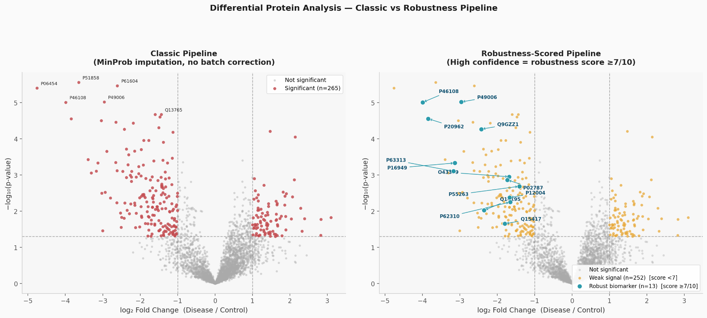
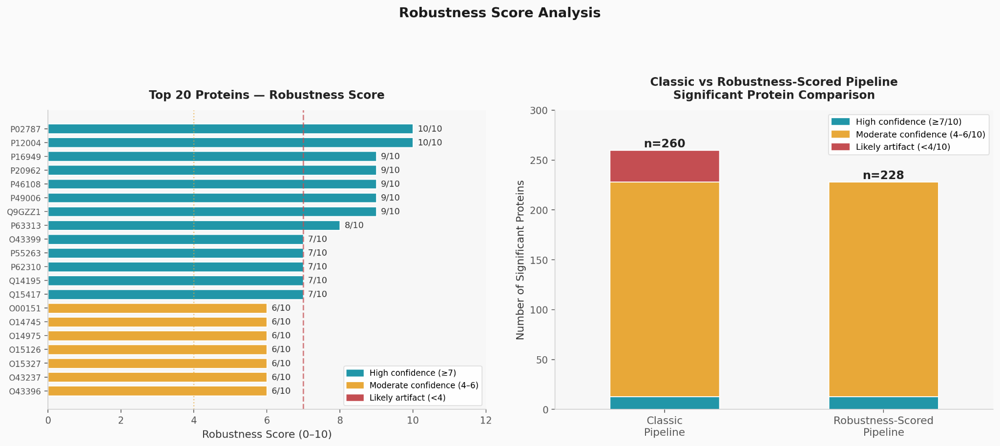

# RobuProt

**Undergraduate course project (student research prototype)**  
**Marmara University · Bioengineering · BIOE 4266 Analytical Techniques in Bioengineering · Spring 2025–2026**  
**Student researchers:** Pınar Nur Özdemir and Öykü Akdeniz  
**Programming implementation:** Pınar Nur Özdemir (with AI-assisted coding tools)

**Research prototype:** Robustness-scored bioinformatics workflow for exploratory biomarker prioritization in LC-MS/MS proteomic data.

RobuProt compares protein-level findings across six analysis scenarios: three missing-value imputation approaches (KNN, an in-house lower-tail method labelled `MinProb`, and median) with and without a batch mean-centering procedure. It generates comparative plots, a heuristic 0–10 robustness score, CSV/TXT summaries, and an automatically assembled Word report.

> **Status:** Developed by undergraduate students for a university course as an educational research exercise, **not** as a professional, commercial, or clinical product. Coursework/research prototype. **Not validated for clinical diagnosis or biomarker selection.** This repository preserves the original analysis implementation. Statistical and metadata issues listed below must be addressed before interpreting the results as scientific evidence.

## Background

Developed as part of **Analytical Techniques in Bioengineering**, Marmara University (2026), by Pınar Nur Özdemir and Öykü Akdeniz. The [co-authored course report](docs/RobuProt_Course_Report_Public.pdf) describes the scientific motivation, methods, and historical project findings. The public copy omits the original cover page because it contained student identification numbers. The report is the **original coursework version**, not a revised validation study. The software implementation was led by Pınar Nur Özdemir, with AI coding assistance. Please cite/credit the original dataset authors and dependencies when reusing material.

## Historical results in the course report

The original course report states that its reference analysis flagged **260 proteins**, categorized as **13 high-score**, **215 moderate-score**, and **32 low-score candidate signals** under the project’s own heuristic criteria. These are **coursework results**, not clinically validated findings. In October 2026, a full local rerun reported the same reference counts (**3,103 analyzed proteins; 260 candidates in the contaminant-filtered reference scenario; 13 high-score, 215 moderate-score, 32 low-score**) in its terminal output. This is a reproducibility check of the existing implementation, **not independent biological or statistical validation**. The assumptions and code limitations below mean these counts may change following scientific corrections.

## Exploratory results — original coursework workflow

The figures below were generated by a student-run execution of the preserved coursework scripts. They illustrate **method-dependent candidate rankings**, not verified biomarkers or validated false-positive elimination. These visualizations should be interpreted together with the [known limitations](#known-limitations--read-before-using-results).

### Differential protein analysis: reference scenario vs heuristic scoring



**Figure 3.** The left panel displays **265 candidates flagged by the reference scenario before removing contaminant/reverse-hit entries**; the comparison in the course report uses **260 after filtering**. The right panel highlights **13 high-score proteins** and **252 other reference-scenario candidates**. Labels like *weak signal* and *robust biomarker* are **the plotting script’s original terminology**, not experimentally established classifications. Significance here uses **unadjusted p-values**, not an FDR-based threshold.

### Exploratory robustness score overview



**Figure 4.** For the **260 contaminant-filtered reference-scenario candidates**, the course heuristic assigned **13 high scores (≥7/10)**, **215 moderate scores (4–6/10)** and **32 low scores (<4/10)**; **228** were retained at the ≥4 threshold. *Likely artifact* in the original chart means **low-scoring under this heuristic**, not a proven false positive. Scores, thresholds and labels have **not** been independently calibrated.

These images are included for transparent presentation of the original student research results. They do not address assumed batch assignments, non-standard MinProb approximation, in-sample ROC-AUC, t-test precision warnings or use of unadjusted p-values; see the limitations section below.

## Workflow

1. `scripts/step1.py` — retrieve public StatOmics `proteinGroups.txt`, select intensity columns, construct sample metadata, log2-transform protein intensities.
2. `scripts/step2.py` — missingness filtering, median centering, exploratory PCA, batch mean-centering and QC plots.
3. `scripts/step3.py` — six imputation/analysis scenarios, differential tests and volcano plots.
4. `scripts/step4.py` — heuristic scoring, rank candidate proteins and export a summary chart/table.
5. `scripts/save_results.py` — textual and CSV summaries.
6. `scripts/report.py` — formatted Word report with figures and tables.

`run_pipeline.py` repeats Step 3 *after* Step 4 to regenerate its volcano plot using the freshly calculated robustness scores. It also deletes prior generated output files before each full run; **back up any output you wish to retain**.

## Installation & execution

Python 3.10+ recommended. Run from the repository root:

```bash
python -m venv .venv
# macOS/Linux:
source .venv/bin/activate
# Windows PowerShell: .venv\Scripts\Activate.ps1
pip install -r requirements.txt
python run_pipeline.py
```

The first stage downloads a **public external dataset** from the URL in `scripts/step1.py`; internet access and continued availability of that URL are required. **Execution check:** A local macOS/Python 3.10 run reported successful completion of the packaged workflow (`Pipeline finished`) and creation of `proteomics_report.docx`, four figures, and CSV/TXT results. Its reference counts matched the course report. This was reported by the student developer from terminal output; the repository does not currently include automated tests or independently verified reproduction logs. Different dependency versions or upstream data changes may lead to different results.

Outputs are created under `data/`, `results/`, `figures/`, and `proteomics_report.docx`. Generated data and tables are omitted from version control by `.gitignore`; **the two illustrative figures above are intentionally tracked**.

## Known limitations — read before using results

- **Batch labels are assumed, not sourced from verified experimental batch metadata.** `step1.py` divides samples into three sequential groups of six. This cannot establish genuine batch effects and may confound biological groups. Statements about removing batch-driven false positives are therefore preliminary.
- **Numerical precision warnings:** Some Welch t-tests emit SciPy `RuntimeWarning: Precision loss occurred` when compared values are nearly identical. Script completion does not resolve the underlying uncertainty; the affected tests require review.
- **Statistical criterion:** `step3.py` calculates Benjamini–Hochberg adjusted FDR values but uses raw `p < 0.05` and `abs(log2FC) > 1` for its `significant` flag. Candidate counts should not be presented as FDR-significant.
- **Non-standard MinProb approximation:** The function named `impute_minprob` is a custom lower-tail normal draw, not an independently validated implementation of MinProb/QRILC. The report currently conflates these methods.
- **Heuristic scores are not empirically calibrated:** Labels such as `High confidence` or `Likely artifact` reflect an internal rule, *not* proven clinical validity or verified false positives.
- **ROC-AUC is computed and scored in-sample** on the same dataset used for the analysis; it does not represent independent predictive validation.
- **Report hard-coded details:** `report.py` includes fixed descriptions and figures (including a claim of 13 top candidates) which may cease to match new data or modified thresholds. Check every generated narrative statement against actual output.
- **Data-source assumptions:** Classification of disease/control relies on sample-name prefixes; check the source's actual experimental design. Duplicate protein identifiers may also need additional handling.

## Scope and possible future work

This repository intentionally preserves the implementation submitted for the student research exercise; **no scientific corrections have been applied to the six original analysis/reporting scripts**. The known issues are documented rather than silently changed so reviewers can distinguish original coursework from potential future refinements.

Possible future work (not part of this version): verify sample groups and authentic batch metadata; evaluate validated imputation implementations and multiple-testing thresholds; add automated tests and dependency pinning; replace hard-coded report narratives; and validate candidate rankings in independent datasets.

## Files to show reviewers

- [Original co-authored research report (public copy)](docs/RobuProt_Course_Report_Public.pdf) — methods, charts, result tables, discussion, limitations.
- `scripts/` — six original Python scripts authored during the project (reorganized/renamed for navigation).
- `run_pipeline.py` — an optional execution helper, added when assembling the GitHub portfolio package.
- `docs/PORTFOLIO_NOTES.md` — plain-language project explanation, contributions, and interpretation caveats.

Two exported PNG figures (`figures/fig3_volcano.png` and `figures/fig4_robustness_barplot.png`) are included as **illustrative original-run outputs**; the pipeline can regenerate all four figures locally. The report contains additional charts. All charts and scores remain exploratory and should be interpreted alongside the limitations above.

## Data and license

Dataset location is specified in `scripts/step1.py` (`StatOmics/pda` hosted on GitHub). Data ownership and the upstream license remain with their respective holders. No software license is included yet; repository owner should choose one after confirming contributions and permissions.
